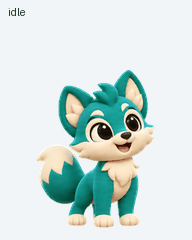
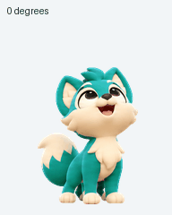

# Пип 🦊

Бирюзовый лисёнок — любопытный и весёлый компаньон для работы и новых идей.

## Что умеет

Моргает, бегает в обе стороны, машет лапой, прыгает, грустит, ждёт ответа, думает и проверяет результат. Ещё у него 16 направлений взгляда.

## Файлы

- `spritesheet.png` — готовый спрайт с прозрачным фоном.
- `sprite-manifest.json` — разметка направлений взгляда.
- Файлы `.gif` и `all-states.mp4` — анимации и видео.
- `pip-concept.png` — исходный образ.
- `contact-sheet.png` и `direction-sheet.png` — все позы и направления.
- `source-prompts.zip` — промпты, использованные для создания рисунков.

## Формат

Спрайт v2: 1536 × 2288 пикселей, сетка 8 × 11, размер ячейки 192 × 208. Всего 73 кадра: девять состояний анимации и 16 направлений взгляда.

Рисунки созданы встроенным imagegen в ChatGPT, собраны и проверены инструментами Pets. Персонаж создан с помощью ИИ.
